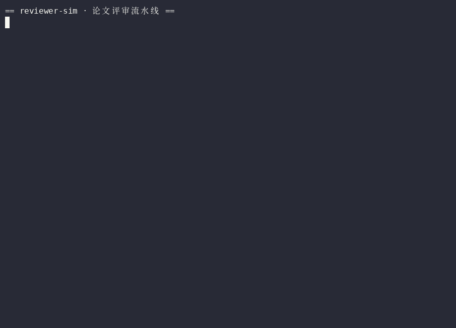
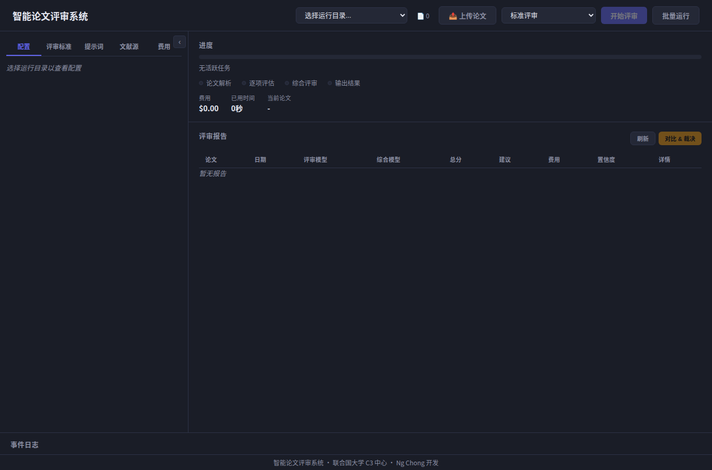

# Agentic Paper Review System

[](https://github.com/aidless/reviewer-sim/actions/workflows/ci.yml)

[](LICENSE)

> 🗂 **仓库族谱**：「论文评审」主线仓是 [review-workflow](https://github.com/aidless/review-workflow)（16 阶段，持续维护）；完整 Web+CLI 版参考已归档的 [agentic-paper-review](https://github.com/aidless/agentic-paper-review)；本仓定位是多角色模拟评审变体。





A domain-agnostic, multi-agent LLM system for structured academic paper review. Ingests PDFs (and other formats), evaluates each paper against custom criteria, and produces scored reviews with optional cross-model adjudication and literature grounding. While designed for academic papers, the fully configurable criteria and prompts make it applicable to any document that needs structured evaluation — grant proposals, project reports, policy briefs, or technical documentation.

**Human oversight is central to the design.** The AI produces structured reviews and scores — the final accept/reject decisions are always made by humans. Multi-model comparison and the AI Judge help reviewers focus where it matters by surfacing the papers where models disagree, rather than requiring manual review of every assessment.


**What has actually been run.** `my_first_review/` holds one end-to-end run (2026-06-28): 12 per-paper reviews and 3 consolidated CSVs, all readable in-repo. No claim is made about review quality versus human reviewers.

**Run it in one command.** `pip install -r requirements.txt && python run_with_custom_params.py --run-dir my_review_run` (needs API keys, see below). This repo ships the code and one worked example, not benchmark numbers.

**Full documentation:** https://c3.unu.edu/projects/ai/paperreview/userguide.html

**Blog article:** https://c3.unu.edu/blog/from-months-to-days-ai-assisted-peer-review-with-human-oversight

## What This Proves / Does Not Prove

**This project proves (as an engineering demonstration):**

- A multi-agent LLM pipeline can be configured to ingest a PDF, decompose an
  evaluation into named criteria, score each criterion on a configurable
  numeric scale with evidence quotes, and synthesize a weighted overall score
  plus a recommendation — with the full weight/scale/threshold logic being
  deterministic and unit-testable (see `tests/`).
- The score → recommendation mapping is a pure function of configurable
  thresholds (sorted descending, first match wins), and the weights are
  validated to sum to 100. This logic is exercised offline by
  `tests/test_scoring.py` and `tests/test_config_loader.py` (38 tests pass).
- Cross-model adjudication (`judge_conflicts.py`) and literature grounding are
  wired in as optional stages.

**This project does NOT prove:**

- That LLM-generated review scores are *valid* or *calibrated* measures of
  paper quality. The scores are model judgments against prompt-defined
  criteria, not measurements validated against any ground-truth labels.
  There is no inter-rater reliability, no human-label correlation, and no
  calibration study in this repository. A score of 43.2 is a model's opinion
  with a documented rationale, not an objective quality estimate.
- That the AI's accept/reject recommendation should be used as the decision.
  **The final decision is always made by a human.** The system is designed to
  *surface* disagreements and evidence, not to *replace* reviewers.
- That literature grounding retrieves a complete or unbiased baseline. The
  librarian queries Semantic Scholar / Arxiv / World Bank with generated
  keywords and a rate limit; recall, precision, and domain coverage are not
  benchmarked here.
- Any claim about a specific paper being "good" or "bad." The bundled
  `my_first_review/` outputs (e.g., the 43.2 and 30.4 scores for the
  resampling-calibration paper) are one run's outputs, not a verdict.

This is a **fail-closed** design: where the pipeline cannot verify (no
ground-truth calibration, no reliability data), it declines to assert validity
rather than implying it.

## Worked Example (real output, committed in-repo)

`my_first_review/` holds one end-to-end run (DeepSeek `deepseek-v4-pro`, 2026-06-28).
The consolidated CSV row, extracted with the actual file in-repo:

```
$ tail -1 my_first_review/outputs/reports/consolidated_reviews_20260628_211226.csv | cut -d, -f1,5,6,7,8
main_1,30.4,拒稿,0.96,0.22231965599999998

# (paper_filename, overall_score, recommendation, confidence, total_cost_usd)
```

Full reviews are plain Markdown, e.g. `my_first_review/outputs/reviews/` — each carries
per-criterion scores with quotes, a verdict, and a confidence level. The CLI demo GIF at
the top of this README reproduces the setup step offline (`setup_run.py` needs no API key).

## Limits

- **Reviews are AI opinions, not ground truth.** No claim is made about review quality
  versus human reviewers; scores and recommendations are inputs to human decisions.
- **The review pipeline makes real LLM calls and costs real money** — the example above
  cost $0.22 per paper. Always test with 5-10 papers before a full batch.
- **The web dashboard has no authentication** — local use only (SSH tunnel for remote).
- `compare_reports.py` / `judge_conflicts.py` need at least two model runs first.
- PDF ingestion depends on the bundled parsers; scanned/image-only PDFs fall back to
  OCR-less extraction and may yield poor text.

## How It Works

The system uses a team of AI agents, each with a distinct role:

| Agent | Role |
|-------|------|
| **Specialist** | Conducts detailed, criterion-by-criterion analysis of each paper |
| **Editor** | Synthesizes specialist findings into a polished final review |
| **Judge** | Resolves conflicts between reviews from different AI models |
| **Librarian** | Searches academic databases for related papers (optional) |
| **Fact-Checker** | Verifies suspicious claims like "first study" (optional) |
| **Critic** | Synthesizes reviews with research trajectory analysis (optional) |

### Pipeline

1. **Ingestion** — PDFs, Markdown, DOCX, and TXT files are read and converted to text.
2. **Extraction** — The Specialist reads the paper once per criterion, extracting scores with evidence and quotes.
3. **Synthesis** — The Editor gathers all specialist reports and writes a final weighted review.
4. **Output** — Individual `.md` reviews and a consolidated `.csv` spreadsheet.
5. **(Optional) Comparison + Judge** — Run with multiple models, compare results, and have an AI Judge adjudicate conflicts.

### Literature Grounding (Optional)

Enable with `--literature-grounding` to add a 4-stage literature analysis:

1. **Librarian** — Searches Semantic Scholar, Arxiv, and World Bank for related papers
2. **Reader** — Extracts evidence and ranks novelty (1-5) against baseline literature
3. **Fact-Checker** — Verifies suspicious claims through targeted searches
4. **Critic** — Synthesizes with research trajectory and novelty-adjusted scoring

## Quick Start

### Installation

```bash
pip install -r requirements.txt
```

### Configure API Keys

Create a `.env` file at the project root (see `.env_example` for all options):

```env
OPENAI_API_KEY=sk-...
DEEPSEEK_API_KEY=sk-...
DEEPSEEK_API_BASE=https://api.deepseek.com/v1
GEMINI_API_KEY=AIza...
ANTHROPIC_API_KEY=sk-ant-...
CUSTOM_OPENAI_API_KEY=your-key
CUSTOM_OPENAI_API_BASE=http://your-server:port/v1

# Model selection (swap freely — any model supported by litellm)
PROVIDER_EXTRACTION=deepseek
EXTRACTOR_MODEL=deepseek-v4-flash
PROVIDER_SYNTHESIS=deepseek
SYNTHESIZER_MODEL=deepseek-v4-flash
JUDGE_PROVIDER=gemini
JUDGE_MODEL=gemini-3.1-flash-lite
```

### Option A: Web Dashboard

```bash
python web_app.py --port 8050
```

Open **http://localhost:8050** to configure models, edit criteria/prompts, run reviews, and view results — all from the browser. See [Web Dashboard](#web-dashboard) for details.

### Option B: Command Line

```bash
# 1. Set up a run directory
python setup_run.py --run-dir my_review_run

# 2. Review criteria and domain BEFORE running
#    Edit my_review_run/input/criteria.yaml — verify that `domain` matches
#    your papers (e.g., computer_science, development_economics).

# 3. Drop papers into my_review_run/papers/

# 4. Run the review
python run_with_custom_params.py \
  --run-dir my_review_run \
  --provider-extraction deepseek \
  --extractor-model deepseek-v4-flash \
  --provider-synthesis openai \
  --synthesizer-model gpt-5.4-mini
```

Results appear in `my_review_run/outputs/reviews/` (individual reviews) and `my_review_run/outputs/reports/` (consolidated CSV).

### Literature-Grounded Review

```bash
python setup_run_literature.py --run-dir my_literature_review
python run_review_with_dir_literature.py \
  --run-dir my_literature_review \
  --literature-grounding
```

### Compare Models + AI Judge

```bash
# Step 1: Run with different models (repeat with different flags)
python run_with_custom_params.py --run-dir my_review_run \
  --provider-extraction openai --extractor-model gpt-5.4-mini \
  --provider-synthesis openai --synthesizer-model gpt-5.4-mini

python run_with_custom_params.py --run-dir my_review_run \
  --provider-extraction deepseek --extractor-model deepseek-v4-flash \
  --provider-synthesis deepseek --synthesizer-model deepseek-v4-flash

# Step 2: Find conflicts
python compare_reports.py --run-dir my_review_run

# Step 3: Adjudicate
python judge_conflicts.py --run-dir my_review_run
```

## Web Dashboard

A built-in web UI for configuring and running reviews from the browser.

### Start the Dashboard

```bash
python web_app.py --port 8050
```

Open **http://localhost:8050**.

> **Note:** The web dashboard is designed for local use only. It has no authentication — do not expose it on a public network or the open internet. If you need remote access, use an SSH tunnel or VPN.

### Features

- **Start/Stop Runs** — Select a run directory, pick Standard or Literature-Grounded mode, and start reviews with one click
- **Real-time Progress** — Live SSE progress bar, stage indicators, cost tracking, and event log
- **Config Editor** — Inline-edit provider, model, temperature, and other settings per run (API keys remain masked and non-editable)
- **Criteria Editor** — Edit `criteria.yaml` directly in the browser with YAML validation
- **Prompt Editor** — Edit all 4 prompt templates (extractor/synthesizer system/user) with template variable hints
- **Literature Sources Editor** — Edit `literature_sources.yaml` with YAML validation
- **Model Costs Editor** — Maintain custom token pricing for models litellm doesn't know (e.g., new DeepSeek releases) with model cost lookup
- **Batch Processing** — "Batch Run" button to sequentially process all run directories with a progress overview
- **Results Table** — Sortable table with scores, recommendations, cost, and one-click review viewing
- **Review Viewer** — Modal viewer with rendered Markdown for individual paper reviews

### Dashboard Tabs

| Tab | Description |
|-----|-------------|
| Config | Inline-editable `.env` settings (providers, models, temperatures, etc.) |
| Criteria | Full YAML editor for review criteria with save/reload and validation |
| Prompts | Select and edit prompt templates with template variable reference |
| Sources | YAML editor for literature source configuration |
| Costs | Custom model token pricing ($/million tokens) for accurate cost tracking |

### CLI vs Web Dashboard

The web dashboard covers common workflows. Some advanced features require the CLI:

| Capability | CLI | Web |
|------------|-----|-----|
| Single-directory review | Yes | Yes |
| Literature-grounded review | Yes | Yes |
| Sequential batch processing | Yes | Yes |
| Parallel batch (`--parallel --max-workers`) | Yes | No |
| Batch setup & paper distribution | Yes | No — call `setup_batch_runs()` (module function, no CLI) |
| No-cache mode (force re-processing) | Yes | No — delete `progress.json` |
| Provider override flags (`--provider-*`) | Yes | Partial — edit `.env` in Config tab |
| Automated conflict comparison | Yes | No — run `compare_reports.py` from CLI |
| Retry & concurrency control | Yes | No |

Use the dashboard for interactive reviews, configuration, and result browsing. Use the CLI for large-scale batch setup, parallel execution, and parameter sweeps.

## Customization

### Review Criteria

Edit `my_review_run/input/criteria.yaml` to define what the system evaluates. Each criterion has an `id`, `name`, `description`, `weight`, and scoring `scale`. All weights must sum to 100.

```yaml
criteria:
  - id: empirical_rigor
    name: Empirical Rigor
    description: |
      Assesses the quality of the empirical methods, data,
      and execution. Look for research design, causal
      identification, and statistical analysis.
    weight: 20
    scale:
      type: numeric
      range: [1, 5]
      labels:
        1: "Fundamentally flawed"
        2: "Significant weaknesses"
        3: "Adequate"
        4: "Strong and robust"
        5: "Exceptional / state-of-the-art"
```

### Agent Prompts

Edit the text files in `my_review_run/input/prompts/` to control agent behavior:

| File | Controls |
|------|----------|
| `extractor_system.txt` | Specialist's role and analytical style |
| `extractor_user.txt` | Extraction task and output schema |
| `synthesizer_system.txt` | Editor's tone and editorial perspective |
| `synthesizer_user.txt` | Synthesis task and review structure |

### Recommendation Thresholds

Default thresholds (configurable in `criteria.yaml`):

| Score | Recommendation |
|-------|---------------|
| 85+ | Accept |
| 70-84 | Accept with Revisions |
| 50-69 | Revise and Resubmit |
| <50 | Reject |

### Domain Specialization

Set the `domain` field in `criteria.yaml` to pivot the entire system to a new field (e.g., `machine_learning`, `clinical_psychology`).

## Batch Processing

Distribute large paper collections across multiple run directories.

There is no `setup_batch_runs.py` CLI. The distribution logic is the function
`setup_batch_runs()` in `setup_batch_runs_literature.py` (no argparse entry
point), so call it from your own driver or a REPL:

```python
from setup_batch_runs_literature import setup_batch_runs
setup_batch_runs(master_papers_dir="papers_master", base_run_dir="run_dir",
                 num_runs=10, papers_per_run=50)
```

Once the run directories exist, the batch driver is a real CLI:

```bash
# Sequential
python run_batch.py

# Parallel
python run_batch.py --parallel --max-workers 4
```

The system tracks progress per directory and resumes automatically after interruptions.

## Supported LLM Providers

All models are configurable via `.env` — no code changes needed when providers release new models.

| Provider | Example Models |
|----------|---------------|
| OpenAI | gpt-5.5, gpt-5.4, gpt-5.4-mini, gpt-5.4-nano |
| DeepSeek | deepseek-v4-pro, deepseek-v4-flash |
| Gemini | gemini-3.5-flash, gemini-3.1-flash-lite |
| Anthropic | claude-opus-4-8, claude-sonnet-4-6, claude-haiku-4-5 |
| Perplexity | sonar, sonar-pro |
| Custom/Ollama | Any OpenAI-compatible endpoint via `CUSTOM_OPENAI_API_BASE` |

You can mix providers — e.g., DeepSeek for extraction, Gemini for judge, OpenAI for synthesis. Token limits are auto-detected via litellm; override per-role with `MAX_TOKENS_EXTRACTION`, `MAX_TOKENS_SYNTHESIS`, `MAX_TOKENS_JUDGE` in `.env`.

## Literature Sources

Configured in `config/literature_sources.yaml`:

| Source | Requires API Key | Citation Data |
|--------|-----------------|---------------|
| Semantic Scholar | Optional (free tier: 100 req/min) | Yes |
| Arxiv | No | No |
| World Bank | No | No |

## Troubleshooting

| Issue | Fix |
|-------|-----|
| `FAILED criterion` / JSON error | Set `MAX_TOKENS_EXTRACTION=32768` in `.env` to increase output limit |
| `Unsupported parameter: max_tokens` | Known issue with some endpoints; the custom_openai bypass handles this automatically |
| `model isn't mapped yet` | Add the model to `_EXTRA_MODELS` in `core/llm_wrapper.py` or set the provider's `*_API_BASE` env var |
| Re-parse papers | Delete `ingestion_cache.json` |
| Re-review papers | Delete `progress.json` |
| Re-adjudicate | Delete `judge_progress.json` |

## Cost Estimation

Each paper is evaluated per criterion (8 criteria = 8 extraction calls) plus one synthesis call, plus one call per conflict for the Judge.

**Prompt caching** significantly reduces extraction costs: the paper content is placed in the system message prefix and cached across all criterion calls for the same paper. The first criterion pays full price; the remaining 7 hit the cache at up to 90% discount (Anthropic) or are auto-cached (OpenAI, DeepSeek). Criteria are extracted in parallel for each paper.

Always test with 5-10 papers first to verify your criteria and estimate costs before committing to a full batch.

## Reproducibility

This repository is a **documentation + offline-testable-logic** deliverable: the
LLM calls require API keys and network, but the scoring/config logic does not.
Everything below can be re-run from a clean checkout.

### Tests

```bash
# From the repo root. No API keys, no network.
python -m pytest tests/ -o addopts="" -q
```

This runs 38 offline tests covering:

- `tests/test_config_loader.py` — criteria weights sum to 100 (global
  `config/criteria.yaml` and the bundled `my_first_review/input/criteria.yaml`),
  thresholds sort descending, default thresholds sane.
- `tests/test_helpers.py` — model-name sanitization, weight-table rendering,
  config hashing, and the novelty score adjustment (bonus/penalty/clamping).
- `tests/test_scoring.py` — `calculate_recommendation` reproduces the exact
  score → recommendation mapping for both the machine-learning run (85/65/45/0)
  and the development-economics default (85/70/50/0), including boundary cases.

### Where the numbers come from

- **Review scores** (e.g., the `43.2` and `30.4` in
  `my_first_review/outputs/reports/`) were produced by a live run on
  `2026-06-28` with DeepSeek V4 Pro, saved as CSV under
  `my_first_review/outputs/reports/consolidated_reviews_*.csv`. To regenerate
  them you must re-run the LLM pipeline (requires `DEEPSEEK_API_KEY`); the
  offline test suite does not regenerate these because they are model outputs.
- **The scoring formula** is deterministic and re-derivable:
  `final_score = (Σ per-criterion weighted score / Σ weights) × 100`, then the
  highest threshold `t` with `final_score >= t` sets the recommendation
  (`agents/agent_synthesizer.py:calculate_recommendation`). The offline tests
  in `tests/test_scoring.py` re-derive both the 100-point and boundary cases.
- **Criteria weights** are read from `criteria.yaml`; both bundled configs sum
  to 100 (asserted in `tests/test_config_loader.py`).

### Honest absence

There is **no benchmark** in this repository measuring review quality against
ground truth, and **no calibration** of scores. The bundled output CSVs are
model judgments, not validated measurements. See "What This Proves / Does Not
Prove" above.

## License

[MIT](LICENSE)

## 结构导览

| 路径 | 内容 |
|------|------|
| `core/` | 评审引擎核心（ingestion / extraction / synthesis / llm_wrapper） |
| `web/` | FastAPI dashboard（`web/static/` 前端） |
| `setup_run.py` / `setup_run_literature.py` | 初始化 run 目录（离线可用） |
| `run_with_custom_params.py` / `run_review_with_dir_literature.py` | 评审主入口（需 API key） |
| `compare_reports.py` / `judge_conflicts.py` | 多模型对比与 Judge 仲裁 |
| `config/` | criteria / prompts / literature_sources / 模型成本模板 |
| `my_first_review/` | 仓库内真实跑通的完整示例（12 份评审 + 3 份汇总 CSV） |
| `docs/` | CLI demo GIF + dashboard 截图 |

## 验收题库与复算

`eval/cases.jsonl` 是 20 条可执行验收题，覆盖十二个口径：配置与权重
（`config/criteria`）、加权计分与推荐映射（`synthesizer/scoring`、
`synthesizer/thresholds`）、文件名清洗与新颖度调整（`helpers/normalize`、
`helpers/novelty`）、配置哈希（`config/hash`）、token 预算与 prompt 前缀缓存
（`llm/token-budget`、`llm/prompt-cache`）、入库元数据与文件哈希
（`ingestor/metadata`、`ingestor/hash`）、进度事件（`progress/events`）与
数据模型校验（`data_models/validation`）。20 条全部是 `expr` / `raises`，
期望值不是抄文档，而是**调用本仓库模块现算**：

```bash
python3 eval/run_cases.py            # 20/20 cases passed
python3 eval/run_cases.py --save     # 顺带把结果写进 eval/run-report.json
python3 eval/run_cases.py --selftest # 篡改第一条期望值，必须变红（19/20）
```

**数字如何复算**：`eval/run-report.json` 里每条 case 都带 `id` / `axis` /
`detail`，把 `detail` 与 `cases.jsonl` 的 `verify` 代码一起看，就能从源码
复现该数字（例如 `SYN-01` 的 80.0 来自 `calculate_recommendation` 对
`Σ(score/5×weight)/Σweight×100` 的计算）；`--save` 重跑一次即可重建整份
报告，不需要手工抄数。`expr` 题按 int/float 容差 1e-9 比较，`raises` 题
断言异常类名（`FileNotFoundError`、`ValidationError`）。

**失败归因**：`run_cases.py` 不只报通过率，失败时按 `axis` 汇总（例如
`config/criteria: 1 条 —— CFG-01`），直接指出是哪个模块的哪个口径坏了；
`--selftest` 必须打印 `19/20` 且归因到被篡改的那条，否则这套题是装饰。
